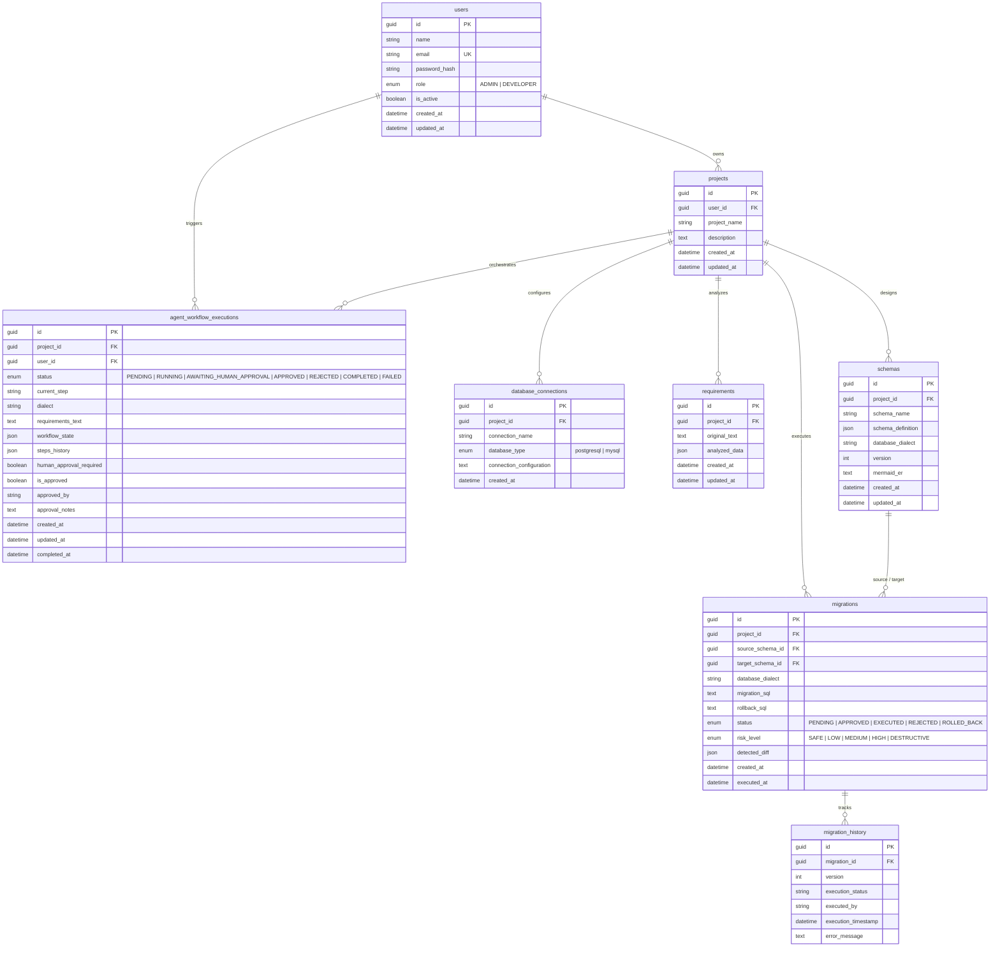
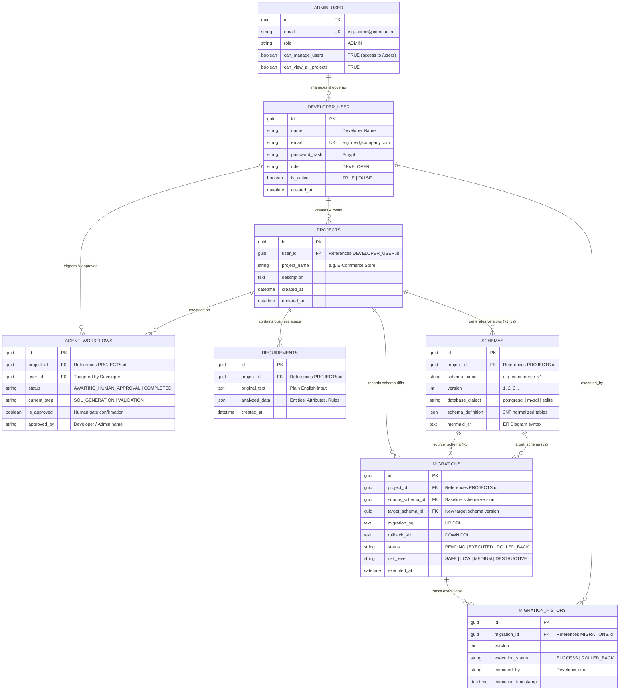
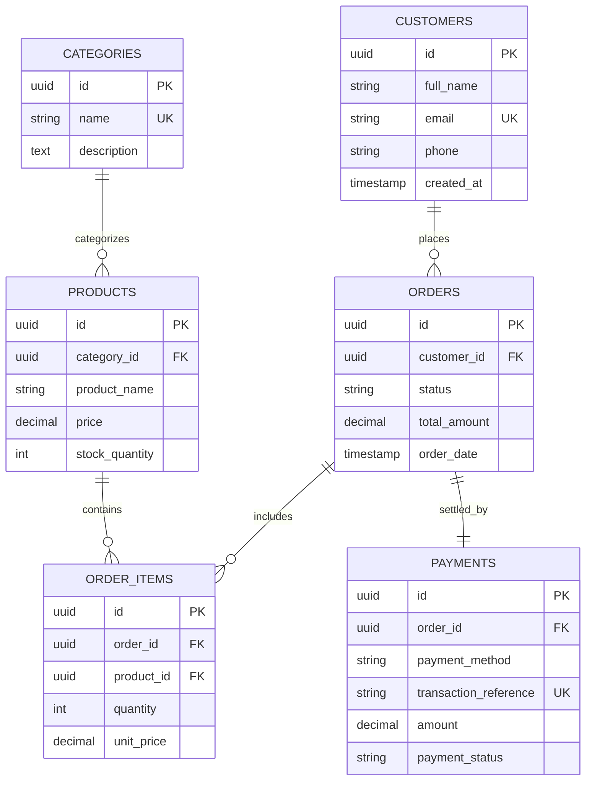

# PlainText-to-DB Schema Migrator

> **Agentic AI-Powered Natural Language to Database Schema Generation and Migration Platform**

Transform plain English requirements into validated database schemas, interactive ER diagrams, dialect-specific DDL scripts, and safe database migration workflows with reversible rollbacks — coordinated autonomously by a specialized multi-agent LangGraph pipeline with human-in-the-loop safety boundaries.

---

## ✨ System Features & Phase Status

| Phase | Milestone | Description | Status |
|:---:|:---|:---|:---:|
| **1** | **Application Foundation & Auth** | JWT auth, bcrypt password hashing, roles (ADMIN/DEVELOPER), project management | ✅ Complete |
| **2** | **Natural Language Requirement Analyzer** | Entity, attribute, constraint, and cardinality extraction via OpenRouter AI + heuristic parser | ✅ Complete |
| **3** | **AI-Powered Schema Designer** | 3NF normalization, junction tables, and interactive Mermaid ER diagrams | ✅ Complete |
| **4** | **SQL Generator & AST Validator** | Dialect-aware DDL (PostgreSQL/MySQL), topological sorting, SQLGlot AST validation | ✅ Complete |
| **5** | **Database Migration & Version Control** | Schema diff comparison, risk level classification (SAFE to DESTRUCTIVE), reversible rollback DDL | ✅ Complete |
| **6** | **LangGraph Multi-Agent Orchestration** | 6 specialized agents, self-correction routing loops, and human-in-the-loop approval gate | ✅ Complete |
| **7** | **Production Readiness & Hardening** | Multi-stage Docker, non-root containers, healthchecks, full test coverage, documentation | ✅ Complete |

---

## 🛠 Technology Stack

- **Frontend**: React 18, TypeScript, Vite, Tailwind CSS, React Router, Axios, Lucide Icons, Mermaid.js, Prism.js
- **Backend**: Python 3.12, FastAPI, SQLAlchemy 2.0 (Asyncpg + Psycopg2), Pydantic v2
- **Agent Framework**: LangGraph StateGraph (State management, conditional edges, human checkpointing)
- **SQL AST Engine**: SQLGlot (AST parsing, dialect validation, relational semantic checks)
- **Database**: PostgreSQL 16 (app data and target), MySQL 8 supported as target
- **AI Connectivity**: OpenRouter API (`OPENROUTER_MODEL` configurable in `.env`), with resilient local fallback
- **Containerization**: Docker, Docker Compose, Multi-stage builds, Unprivileged `appuser`

---

## 🤖 The Multi-Agent Workflow

```
[Plain English Requirements]
             │
             ▼
[1. Requirement Analyzer Agent] ──► Extracts Entities, Attributes & Cardinality
             │
             ▼
[2. Schema Designer Agent] ───────► Normalizes to 3NF, Creates Junction Tables, Generates ER Code
             │
             ▼
[3. SQL Generator Agent] ─────────► Synthesizes Topologically Sorted DDL
             │
             ▼
[4. SQL Validation Agent] ────────► SQLGlot AST Syntax & Relational Check
       │                   ▲
       │ (If AST Invalid)  │ (Self-Correction Loop)
       └───────────────────┘
       │ (If AST Valid)
       ▼
[5. Review & Risk Sentinel Agent] ─► Evaluates Quality & Assesses Migration Risk Level
             │
             ▼
[6. Migration Generator Agent] ───► Emits Forward Evolution DDL & Reversible Rollback SQL
             │
             ▼
[7. Human Approval Gate] ─────────► Pauses at AWAITING_HUMAN_APPROVAL until approved by user
             │
             ▼
     [Database Migration Applied & Version History Recorded]
```

---

## 📊 Entity Relationship (ER) Diagrams

### 1. Platform System Data Model (Core Database)
The following ER diagram represents the internal database schema powering the PlainText-to-DB Migrator:



### 2. Developer (User) Project Ownership & Lifecycle ER Diagram
This diagram focuses specifically on the **Developer (User)** journey within a Project — illustrating how a developer account owns projects, manages natural language requirements, oversees schema revisions, and controls autonomous agent executions and migration histories:



### 3. Example AI-Generated Application ER Diagram (E-Commerce)
When a user provides natural language requirements, the **Schema Designer Agent** synthesizes a normalized 3NF ER diagram rendered interactively in the web application:



---

## 🚀 Quick Start

For full installation and configuration steps, see [SETUP.md](./SETUP.md). For detailed architectural specs, see [ARCHITECTURE.md](./ARCHITECTURE.md).

### Run with Docker Compose (Recommended)

```powershell
# Copy environment configuration
copy .env.example .env

# Start all services with one command
docker compose up --build
```

- **Frontend App**: [http://localhost:5173](http://localhost:5173)
- **Backend API**: [http://localhost:8000](http://localhost:8000)
- **Swagger Documentation**: [http://localhost:8000/docs](http://localhost:8000/docs)
- **Health Check**: [http://localhost:8000/health](http://localhost:8000/health)

### Run Locally (Without Docker)

```powershell
# 1. Backend
cd backend
python -m pip install -r requirements.txt
python -m uvicorn app.main:app --reload --host 0.0.0.0 --port 8000

# 2. Frontend (in a separate terminal)
cd frontend
npm install
npm run dev
```

---

## 🧪 Testing & Verification

Run the full automated test suite covering all phases:

```powershell
cd backend
python -m pytest tests/test_phase2.py tests/test_phase3.py tests/test_phase4.py tests/test_phase5.py tests/test_phase6.py -v
```

Run frontend production build verification:

```powershell
cd frontend
npm run build
```

---

## 📁 Repository Structure

```
plaintext-db-migrator/
├── frontend/                  # React 18 + Vite + TypeScript + Tailwind
│   ├── src/
│   │   ├── components/        # Button, Card, Input, SQLEditor, MermaidRenderer, Navbar
│   │   ├── pages/             # Dashboard, Projects, Requirements, SchemaDesignerTab,
│   │   │                      # SQLGeneratorTab, MigrationTab, AgentWorkflowTab
│   │   ├── services/          # auth, project, requirement, schema, sql, migration, agent
│   │   └── types/             # Pydantic-mirrored TypeScript domain interfaces
│   ├── Dockerfile             # Multi-stage static build with Nginx on port 5173
│   └── nginx.conf             # Production proxy and SPA routing
├── backend/                   # FastAPI + LangGraph + SQLGlot + SQLAlchemy
│   ├── app/
│   │   ├── api/v1/            # auth, projects, requirements, schemas, sql, migrations, agents
│   │   ├── auth/              # JWT issuance, verification, role-based guard
│   │   ├── database/          # Async session engine & model base
│   │   ├── models/            # SQLAlchemy models (User, Project, Schema, Migration, History, Workflow)
│   │   ├── schemas/           # Pydantic v2 schemas
│   │   ├── services/          # ai_analyzer, schema_designer, sql_agent, migration_engine, agent_workflow
│   │   └── main.py            # FastAPI entry point, CORS, and healthcheck
│   ├── tests/                 # Unit tests (Phases 2 through 6)
│   ├── requirements.txt       # Hardened Python dependencies
│   └── Dockerfile             # Multi-stage unprivileged (non-root) container
├── docker-compose.yml         # Full-stack composition (postgres, backend, frontend)
├── .env.example               # Environment variables template
├── ARCHITECTURE.md            # Comprehensive system and agent architecture document
├── SETUP.md                   # Complete local and containerized setup guide
└── README.md                  # Project overview and user documentation
```
